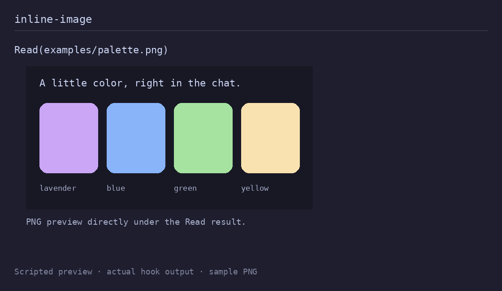
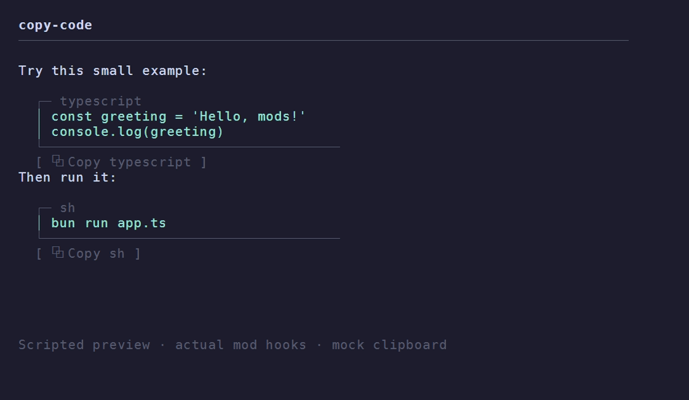

# mods

Small mods for Claude Code: see images in the conversation and copy individual code blocks.

| Mod | What it adds |
| --- | --- |
| [inline-image](#inline-image) | A PNG preview directly below the Read result. |
| [copy-code](#copy-code) | A copy button under each code block, plus `/copy-code`. |

## inline-image

See the image Claude just opened without leaving the conversation. The preview appears under the Read result, including when reads are folded into a group.



- Works in a terminal with Kitty graphics support, such as kitty or Ghostty.
- PNG only, up to 2 MiB. Larger images and other formats get a short explanation.
- Terminals without image support show the filename instead.

## copy-code

Copy one fenced code block from a reply. Each block gets its own button; after a successful copy, that button reads **Copied** for two seconds.



Prefer the keyboard? Run `/copy-code` for the latest reply. If it contains several blocks, the command lists them; `/copy-code 2` copies the second one.

Clickable terminal buttons need fullscreen mode: run `/tui fullscreen` once. Direct terminal copying uses OSC 52 and a Linux shell helper; if that fails, the mod tries Claude Code's built-in copy.

## Try the UI mods

From a checkout of this repository:

```sh
claude --plugin-dir ./mods/inline-image --plugin-dir ./mods/copy-code
```

This loads both mods for that session. To try just one, pass only its directory. These mods use Claude Code's mods API, validated with Claude Code 2.1.325.
